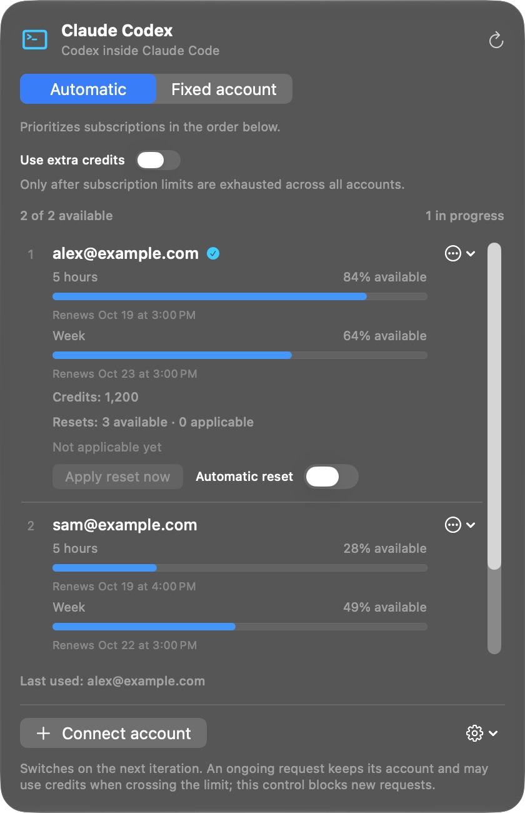

**English** · [Português (Brasil)](docs/readme/README_pt-BR.md) · [Español](docs/readme/README_es.md) · [Français](docs/readme/README_fr.md) · [Deutsch](docs/readme/README_de.md) · [Italiano](docs/readme/README_it.md)

  

# Claude Codex

**Use your Codex subscriptions inside Claude Code. No API key needed.**

Claude Codex is a native Mac menu-bar app that connects your OpenAI/Codex accounts to Claude Code in the Claude desktop app. It creates a separate Claude installation with its own data and settings, preserving your original setup.

Connect multiple accounts, choose their order, and follow each account’s usage, renewal times, credits and resets in one panel.

**[Download for Mac](https://github.com/reyhenrick/claude-codex/releases/latest/download/ClaudeCodex-macOS.dmg)**

macOS 26 or later · Apple silicon and Intel · Free and open source

Requires an account with Codex access and the official Claude app installed. Model usage follows your account’s limits and billing.

  
   Screenshot of the running app with synthetic accounts and usage data.

## Install and connect

1. Open the DMG, drag **Claude Codex** to **Applications**, and open it.
2. Click **Connect account** and complete sign-in on the official OpenAI page. Repeat for each account you want to use.
3. Open **App options → New Claude installation…** and select your installed official Claude app.
4. Name the separate installation and choose whether to migrate compatible local data. Close the source Claude app before migration.
5. Click **Create installation**, then open the new app from Finder to start using Claude Code with your Codex accounts.

The download includes its runtime; Node.js and Python do not need to be installed separately. The app is not notarized by Apple. If macOS blocks the first launch, follow [Apple’s instructions](https://support.apple.com/en-us/102445).

## Models and agent workflows

Use **GPT-6.1 Sol, GPT-6 Luna and GPT-6 Astra** with Claude Code’s tools, subagents and Workflows. Select the native reasoning effort and the speed variants available to your accounts. Sol and Astra support Normal, Fast and Ultrafast; Luna supports Normal and Fast. Availability and consumption are determined by OpenAI.

Reopen the separate Claude installation after changing accounts or model access to refresh its model menu. Account selection itself takes effect on the next model request.

## Multiple accounts, limits and resets

- **Automatic:** tries eligible accounts in your chosen order. **Fixed account:** uses only the account you select.
- **Usage:** shows subscription limits, renewal times, extra credits and available resets for each account.
- **Extra credits:** off by default. Enabling them allows new requests to use credits only after subscription limits are confirmed exhausted across all connected accounts.
- **Resets:** apply an available reset manually with confirmation, or enable automatic resets per account at 5% remaining or less, when eligible. Automatic resets are off by default.

Switching applies to the next model request, including the next step after a tool call. A request already underway keeps its original account and may cross a quota boundary and consume credits under the provider’s rules.

## Bring your local context

Migrate compatible local Claude Code history, instructions, memories and skills. The original data is preserved, and **Show migration report** lists what was copied or skipped. Cloud-only conversations and credentials are not imported; some local history is preserved as portable files rather than resumable sessions.

The connection runs locally on your Mac. Model requests and tool results are sent to OpenAI through the selected account. Claude Codex has no telemetry of its own.

## Updates

Update checks are automatic. Use **Check for updates…** in App options to install a release. Automatic installation is optional and off by default; installation waits for active conversations and account operations to finish. This updates Claude Codex, not the separate copy of Claude.

## Documentation and contributions

See [CONTRIBUTING.md](CONTRIBUTING.md) for building, testing, translations and capturing the interface with synthetic accounts. The [technical reference (Português)](docs/TECHNICAL_GUIDE_pt-BR.md) documents migration, context, account policies, privacy, packaging and removal in detail.

[Report an issue](https://github.com/reyhenrick/claude-codex/issues) · [Releases](https://github.com/reyhenrick/claude-codex/releases) · [MIT license](LICENSE) · [Third-party notices](THIRD_PARTY_NOTICES.md)

Independent project, not affiliated with OpenAI or Anthropic.
