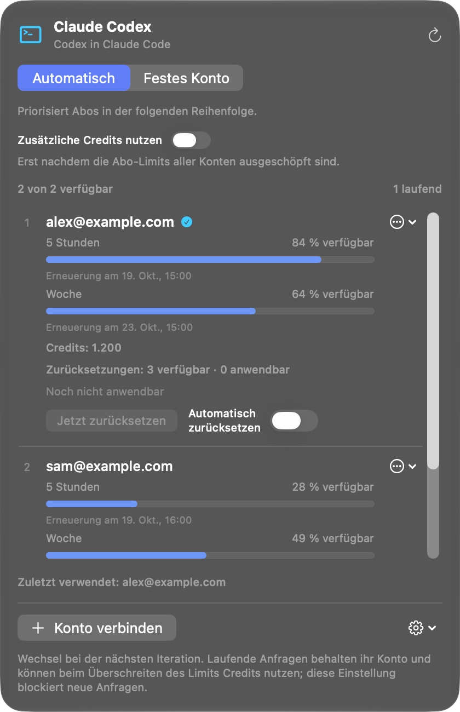

[English](../../README.md) · [Português (Brasil)](README_pt-BR.md) · [Español](README_es.md) · [Français](README_fr.md) · **Deutsch** · [Italiano](README_it.md)

  

# Claude Codex

**Codex-Abonnements in Claude Code nutzen. Ohne API-Schlüssel.**

Claude Codex ist eine native App für die Mac-Menüleiste, die Ihre OpenAI-/Codex-Konten mit Claude Code in der Claude-Desktop-App verbindet. Sie erstellt eine separate Claude-Installation mit eigenen Daten und Einstellungen. Ihre ursprüngliche Installation bleibt erhalten.

Verbinden Sie mehrere Konten, legen Sie deren Reihenfolge fest und sehen Sie Kontingente, Erneuerungszeiten, Credits und verfügbare Zurücksetzungen für jedes Konto in einem Panel.

**[Für Mac herunterladen](https://github.com/reyhenrick/claude-codex/releases/latest/download/ClaudeCodex-macOS.dmg)**

macOS 26 oder neuer · Apple silicon und Intel · Kostenlos und Open Source

Erfordert ein Konto mit Codex-Zugang und die installierte offizielle Claude-App. Für die Modellnutzung gelten die Limits und Abrechnungsregeln Ihres Kontos.

  
   Screenshot der laufenden App mit fiktiven Konten und Nutzungsdaten.

## Installieren und verbinden

1. Öffnen Sie die DMG-Datei, ziehen Sie **Claude Codex** in **Programme** und öffnen Sie die App.
2. Klicken Sie auf **Konto verbinden** und melden Sie sich auf der offiziellen OpenAI-Seite an. Wiederholen Sie dies für jedes gewünschte Konto.
3. Öffnen Sie **App-Optionen → Neue Claude-Installation…** und wählen Sie die installierte offizielle Claude-App aus.
4. Benennen Sie die separate Installation und entscheiden Sie, ob kompatible lokale Daten übernommen werden sollen. Schließen Sie die ursprüngliche Claude-App vor der Übernahme.
5. Klicken Sie auf **Installation erstellen** und öffnen Sie die neue App im Finder, um Claude Code mit Ihren Codex-Konten zu nutzen.

Der Download enthält die erforderliche Laufzeitumgebung; Node.js und Python müssen nicht separat installiert werden. Die App ist nicht von Apple notarisiert. Falls macOS den ersten Start blockiert, folgen Sie [Apples Anleitung](https://support.apple.com/de-de/102445).

## Modelle und Agenten

Nutzen Sie **GPT-6.1 Sol, GPT-6 Luna und GPT-6 Astra** mit den Werkzeugen, Unteragenten und Workflows von Claude Code. Wählen Sie die native Reasoning-Stufe und die für Ihre Konten verfügbaren Geschwindigkeitsvarianten. Sol und Astra bieten Normal, Fast und Ultrafast; Luna bietet Normal und Fast. Verfügbarkeit und Verbrauch werden von OpenAI bestimmt.

Öffnen Sie die separate Claude-Installation nach Änderungen an Konten oder Modellzugängen erneut, um das Modellmenü zu aktualisieren. Die Kontowahl selbst gilt bereits für die nächste Modellanfrage.

## Mehrere Konten, Limits und Zurücksetzungen

- **Automatisch:** versucht berechtigte Konten in der festgelegten Reihenfolge. **Festes Konto:** verwendet ausschließlich das ausgewählte Konto.
- **Nutzung:** zeigt Abonnementlimits, Erneuerungszeiten, zusätzliche Credits und verfügbare Zurücksetzungen für jedes Konto.
- **Zusätzliche Credits:** standardmäßig deaktiviert. Nach der Aktivierung dürfen neue Anfragen erst dann Credits verwenden, wenn die Abonnementlimits aller verbundenen Konten nachweislich ausgeschöpft sind.
- **Zurücksetzungen:** wenden Sie eine verfügbare Zurücksetzung manuell mit Bestätigung an oder aktivieren Sie automatische Zurücksetzungen je Konto bei höchstens 5 % Restkontingent, sofern das Konto berechtigt ist. Automatische Zurücksetzungen sind standardmäßig deaktiviert.

Ein Wechsel gilt für die nächste Modellanfrage, auch für den nächsten Schritt nach einem Werkzeugaufruf. Eine bereits laufende Anfrage behält ihr ursprüngliches Konto und kann ein Limit überschreiten und gemäß den Regeln des Anbieters Credits verbrauchen.

## Lokalen Kontext übernehmen

Übernehmen Sie kompatible lokale Claude-Code-Verläufe, Anweisungen, Erinnerungen und Skills. Die ursprünglichen Daten bleiben erhalten. **Übernahmebericht anzeigen** listet kopierte und übersprungene Elemente auf. Zugangsdaten und ausschließlich in der Cloud gespeicherte Gespräche werden nicht importiert; einige lokale Verläufe werden als portable Dateien statt als fortsetzbare Sitzungen gespeichert.

Die Verbindung läuft lokal auf Ihrem Mac. Modellanfragen und Werkzeugergebnisse werden über das ausgewählte Konto an OpenAI gesendet. Claude Codex besitzt keine eigene Telemetrie.

## Updates

Die Suche nach Updates erfolgt automatisch. Verwenden Sie **Nach Updates suchen…** in den App-Optionen, um eine Version zu installieren. Die automatische Installation ist optional und standardmäßig deaktiviert; die Installation wartet, bis laufende Gespräche und Kontovorgänge abgeschlossen sind. Aktualisiert wird Claude Codex, nicht die separate Claude-Kopie.

## Dokumentation und Beiträge

[CONTRIBUTING.md (English)](../../CONTRIBUTING.md) beschreibt Build, Tests, Übersetzungen und die Erstellung der Screenshots mit fiktiven Daten. Die [technische Referenz (Português)](../TECHNICAL_GUIDE_pt-BR.md) erläutert Datenübernahme, Kontext, Kontoregeln, Datenschutz, Paketierung und Deinstallation.

[Problem melden](https://github.com/reyhenrick/claude-codex/issues) · [Versionen](https://github.com/reyhenrick/claude-codex/releases) · [MIT-Lizenz](../../LICENSE) · [Hinweise zu Drittanbietern](../../THIRD_PARTY_NOTICES.md)

Unabhängiges Projekt ohne Verbindung zu OpenAI oder Anthropic.
