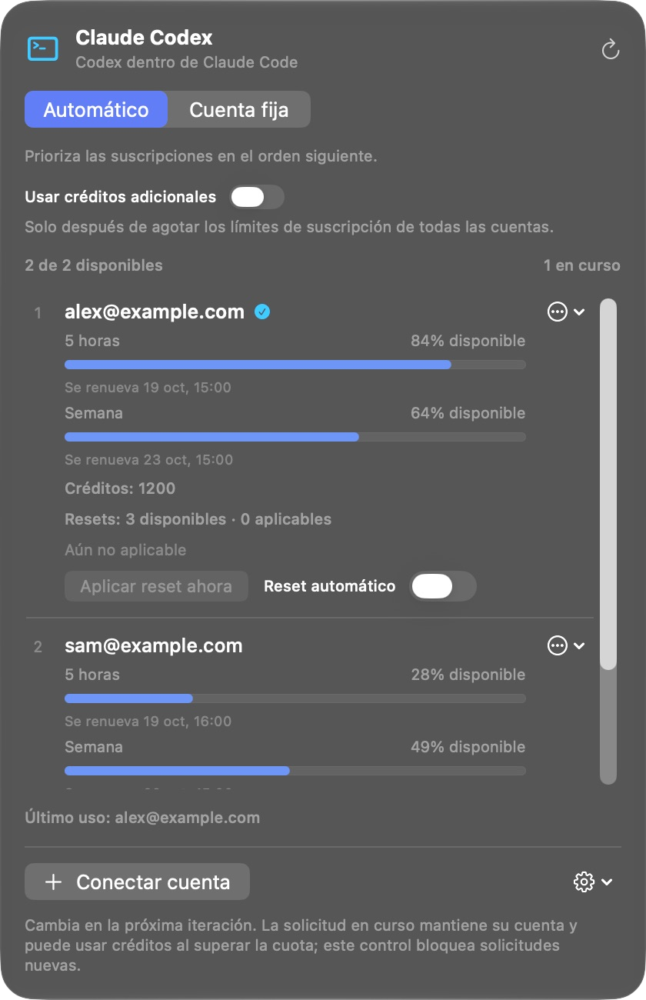

[English](../../README.md) · [Português (Brasil)](README_pt-BR.md) · **Español** · [Français](README_fr.md) · [Deutsch](README_de.md) · [Italiano](README_it.md)

  

# Claude Codex

**Usa tus suscripciones de Codex dentro de Claude Code. Sin clave de API.**

Claude Codex es una app nativa para la barra de menús del Mac que conecta tus cuentas OpenAI/Codex con Claude Code en la aplicación de escritorio de Claude. Crea una instalación independiente de Claude, con sus propios datos y ajustes, y conserva tu instalación original.

Conecta varias cuentas, define su orden de uso y consulta los límites, las renovaciones, los créditos y los resets de cada una en un solo panel.

**[Descargar para Mac](https://github.com/reyhenrick/claude-codex/releases/latest/download/ClaudeCodex-macOS.dmg)**

macOS 26 o posterior · Apple silicon e Intel · Gratis y de código abierto

Requiere una cuenta con acceso a Codex y la app oficial de Claude instalada. El uso de los modelos está sujeto a los límites y la facturación de tu cuenta.

  
   Captura de pantalla de la app en ejecución con cuentas y datos de uso sintéticos.

## Instalar y conectar

1. Abre el DMG, arrastra **Claude Codex** a **Aplicaciones** y ábrelo.
2. Pulsa **Conectar cuenta** e inicia sesión en la página oficial de OpenAI. Repite el proceso con cada cuenta que quieras usar.
3. Abre **Opciones de la app → Nueva instalación de Claude…** y selecciona la app oficial de Claude instalada.
4. Asigna un nombre a la instalación independiente y decide si quieres migrar datos locales compatibles. Cierra la app de Claude de origen antes de migrarlos.
5. Pulsa **Crear instalación** y abre la nueva app desde Finder para usar Claude Code con tus cuentas de Codex.

La descarga incluye el entorno de ejecución necesario; no hace falta instalar Node.js ni Python por separado. La app no está notarizada por Apple. Si macOS bloquea la primera apertura, sigue las [instrucciones de Apple](https://support.apple.com/es-es/102445).

## Modelos y trabajo con agentes

Usa **GPT-6.1 Sol, GPT-6 Luna y GPT-6 Astra** con las herramientas, los subagentes y los Workflows de Claude Code. Selecciona el esfuerzo de razonamiento nativo y las variantes de velocidad disponibles para tus cuentas. Sol y Astra ofrecen Normal, Fast y Ultrafast; Luna ofrece Normal y Fast. OpenAI determina la disponibilidad y el consumo.

Vuelve a abrir la instalación independiente de Claude después de cambiar las cuentas o su acceso a modelos para actualizar el menú de modelos. La selección de cuenta se aplica a la siguiente solicitud al modelo.

## Varias cuentas, límites y resets

- **Automático:** prueba las cuentas elegibles en el orden que hayas elegido. **Cuenta fija:** utiliza únicamente la cuenta seleccionada.
- **Uso:** muestra los límites de suscripción, las renovaciones, los créditos adicionales y los resets disponibles de cada cuenta.
- **Créditos adicionales:** desactivados de forma predeterminada. Al activarlos, las nuevas solicitudes pueden usar créditos solo cuando se haya confirmado el agotamiento de los límites de suscripción de todas las cuentas conectadas.
- **Resets:** aplica un reset disponible manualmente, con confirmación, o activa los resets automáticos por cuenta cuando quede un 5% o menos y la cuenta sea elegible. Los resets automáticos están desactivados de forma predeterminada.

El cambio se aplica a la siguiente solicitud al modelo, incluido el siguiente paso después de una herramienta. Una solicitud ya iniciada mantiene su cuenta original y puede superar el límite y consumir créditos según las reglas del proveedor.

## Trae tu contexto local

Migra historiales locales compatibles de Claude Code, instrucciones, memorias y skills. Se conservan los datos originales y **Mostrar informe de migración** detalla lo copiado y lo omitido. No se importan credenciales ni conversaciones que solo estén en la nube; parte del historial local se conserva como archivos portátiles en lugar de sesiones que puedan reanudarse.

La conexión se ejecuta localmente en tu Mac. Las solicitudes a los modelos y los resultados de las herramientas se envían a OpenAI a través de la cuenta seleccionada. Claude Codex no tiene telemetría propia.

## Actualizaciones

La búsqueda de actualizaciones es automática. Usa **Buscar actualizaciones…** en Opciones de la app para instalar una versión. La instalación automática es opcional y está desactivada de forma predeterminada; la instalación espera a que terminen las conversaciones y operaciones de cuenta activas. Se actualiza Claude Codex, no la copia independiente de Claude.

## Documentación y contribuciones

Consulta [CONTRIBUTING.md (English)](../../CONTRIBUTING.md) para compilar, probar, traducir y reproducir las capturas con cuentas ficticias. La [referencia técnica (Português)](../TECHNICAL_GUIDE_pt-BR.md) detalla la migración, el contexto, las políticas de cuentas, la privacidad, el empaquetado y la desinstalación.

[Informar de un problema](https://github.com/reyhenrick/claude-codex/issues) · [Versiones](https://github.com/reyhenrick/claude-codex/releases) · [Licencia MIT](../../LICENSE) · [Avisos de terceros](../../THIRD_PARTY_NOTICES.md)

Proyecto independiente, sin afiliación con OpenAI ni Anthropic.
