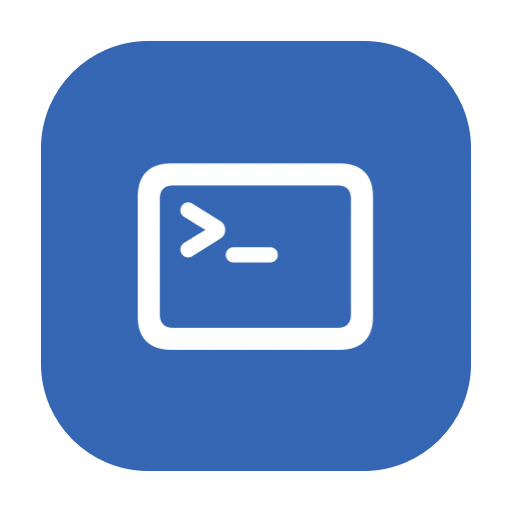
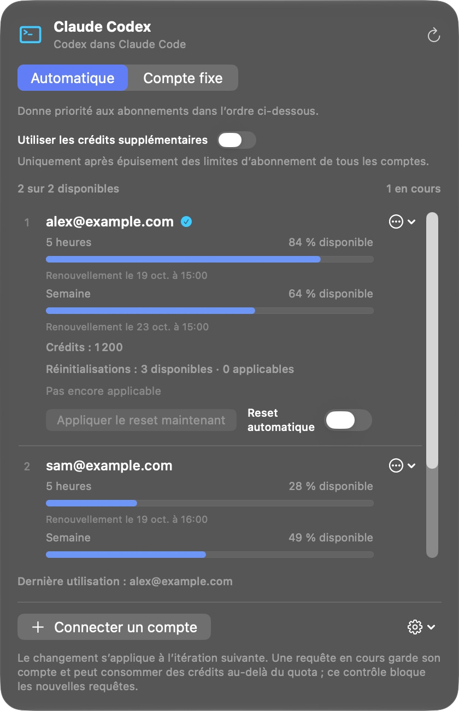

[English](../../README.md) · [Português (Brasil)](README_pt-BR.md) · [Español](README_es.md) · **Français** · [Deutsch](README_de.md) · [Italiano](README_it.md)

  

# Claude Codex

**Utilisez vos abonnements Codex dans Claude Code. Sans clé API.**

Claude Codex est une application native pour la barre de menus du Mac qui connecte vos comptes OpenAI/Codex à Claude Code dans l’application de bureau Claude. Elle crée une installation séparée de Claude, avec ses propres données et réglages, en préservant votre installation d’origine.

Connectez plusieurs comptes, définissez leur ordre d’utilisation et consultez les quotas, renouvellements, crédits et réinitialisations de chaque compte dans un seul panneau.

**[Télécharger pour Mac](https://github.com/reyhenrick/claude-codex/releases/latest/download/ClaudeCodex-macOS.dmg)**

macOS 26 ou ultérieur · Apple silicon et Intel · Gratuit et open source

Nécessite un compte ayant accès à Codex et l’application officielle Claude installée. L’utilisation des modèles est soumise aux limites et à la facturation de votre compte.

  
   Capture d’écran de l’application en cours d’exécution avec des comptes et données d’utilisation fictifs.

## Installer et connecter

1. Ouvrez le DMG, glissez **Claude Codex** dans **Applications**, puis ouvrez l’application.
2. Cliquez sur **Connecter un compte** et identifiez-vous sur la page officielle d’OpenAI. Répétez l’opération pour chaque compte souhaité.
3. Ouvrez **Options de l’application → Nouvelle installation de Claude…** et sélectionnez l’application officielle Claude installée.
4. Nommez l’installation séparée et choisissez si vous souhaitez migrer les données locales compatibles. Fermez l’application Claude source avant la migration.
5. Cliquez sur **Créer l’installation**, puis ouvrez la nouvelle application depuis le Finder pour utiliser Claude Code avec vos comptes Codex.

Le téléchargement inclut l’environnement d’exécution nécessaire ; Node.js et Python n’ont pas à être installés séparément. L’application n’est pas notariée par Apple. Si macOS bloque la première ouverture, suivez les [instructions d’Apple](https://support.apple.com/fr-fr/102445).

## Modèles et travail avec les agents

Utilisez **GPT-6.1 Sol, GPT-6 Luna et GPT-6 Astra** avec les outils, sous-agents et Workflows de Claude Code. Sélectionnez le niveau d’effort de raisonnement natif et les variantes de vitesse disponibles pour vos comptes. Sol et Astra proposent Normal, Fast et Ultrafast ; Luna propose Normal et Fast. OpenAI détermine la disponibilité et la consommation.

Rouvrez l’installation séparée de Claude après une modification des comptes ou des accès aux modèles pour actualiser le menu des modèles. Le choix du compte s’applique dès la prochaine requête au modèle.

## Plusieurs comptes, quotas et réinitialisations

- **Automatique :** essaie les comptes éligibles dans l’ordre choisi. **Compte fixe :** utilise uniquement le compte sélectionné.
- **Utilisation :** affiche les quotas d’abonnement, renouvellements, crédits supplémentaires et réinitialisations disponibles pour chaque compte.
- **Crédits supplémentaires :** désactivés par défaut. Leur activation autorise les nouvelles requêtes à utiliser des crédits uniquement après confirmation de l’épuisement des quotas d’abonnement de tous les comptes connectés.
- **Réinitialisations :** appliquez une réinitialisation disponible manuellement, avec confirmation, ou activez les réinitialisations automatiques par compte lorsqu’il reste 5 % ou moins et que le compte est éligible. Elles sont désactivées par défaut.

Le changement s’applique à la prochaine requête au modèle, y compris à l’étape suivant un appel d’outil. Une requête déjà commencée conserve son compte d’origine et peut dépasser un quota et consommer des crédits selon les règles du fournisseur.

## Retrouvez votre contexte local

Migrez l’historique local compatible de Claude Code, les instructions, mémoires et skills. Les données d’origine sont préservées et **Afficher le rapport de migration** indique les éléments copiés ou ignorés. Les identifiants et conversations uniquement stockées dans le cloud ne sont pas importés ; une partie de l’historique local est conservée sous forme de fichiers portables plutôt que de sessions pouvant être reprises.

La connexion s’exécute localement sur votre Mac. Les requêtes aux modèles et les résultats des outils sont transmis à OpenAI via le compte sélectionné. Claude Codex ne possède pas de télémétrie propre.

## Mises à jour

La recherche de mises à jour est automatique. Utilisez **Rechercher des mises à jour…** dans les Options de l’application pour installer une version. L’installation automatique est facultative et désactivée par défaut ; l’installation attend la fin des conversations et opérations de compte en cours. Elle met à jour Claude Codex, pas la copie séparée de Claude.

## Documentation et contributions

Consultez [CONTRIBUTING.md (English)](../../CONTRIBUTING.md) pour la compilation, les tests, les traductions et la reproduction des captures avec des données fictives. La [référence technique (Português)](../TECHNICAL_GUIDE_pt-BR.md) détaille la migration, le contexte, les règles des comptes, la confidentialité, la distribution et la désinstallation.

[Signaler un problème](https://github.com/reyhenrick/claude-codex/issues) · [Versions](https://github.com/reyhenrick/claude-codex/releases) · [Licence MIT](../../LICENSE) · [Avis relatifs aux composants tiers](../../THIRD_PARTY_NOTICES.md)

Projet indépendant, sans affiliation avec OpenAI ou Anthropic.
