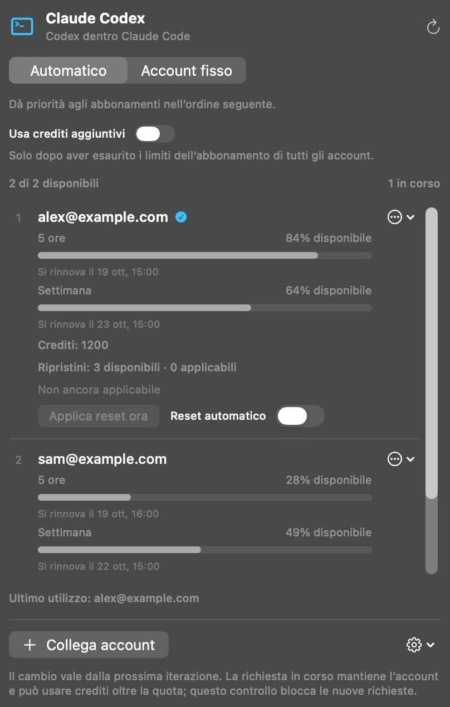

[English](../../README.md) · [Português (Brasil)](README_pt-BR.md) · [Español](README_es.md) · [Français](README_fr.md) · [Deutsch](README_de.md) · **Italiano**

  

# Claude Codex

**Usa i tuoi abbonamenti Codex dentro Claude Code. Senza chiave API.**

Claude Codex è un’app nativa per la barra dei menu del Mac che collega i tuoi account OpenAI/Codex a Claude Code nell’app desktop di Claude. Crea un’installazione separata di Claude, con dati e impostazioni propri, preservando quella originale.

Collega più account, scegli l’ordine di utilizzo e consulta quote, rinnovi, crediti e reset di ciascuno in un unico pannello.

**[Scarica per Mac](https://github.com/reyhenrick/claude-codex/releases/latest/download/ClaudeCodex-macOS.dmg)**

macOS 26 o successivo · Apple silicon e Intel · Gratuito e open source

Richiede un account con accesso a Codex e l’app ufficiale di Claude installata. L’uso dei modelli segue i limiti e le regole di fatturazione del tuo account.

  
   Screenshot dell’app in esecuzione con account e dati di utilizzo fittizi.

## Installa e collega

1. Apri il DMG, trascina **Claude Codex** in **Applicazioni** e apri l’app.
2. Fai clic su **Collega account** e accedi sulla pagina ufficiale di OpenAI. Ripeti per ogni account che vuoi usare.
3. Apri **Opzioni dell’app → Nuova installazione di Claude…** e seleziona l’app ufficiale di Claude installata.
4. Assegna un nome all’installazione separata e scegli se migrare i dati locali compatibili. Chiudi l’app Claude di origine prima della migrazione.
5. Fai clic su **Crea installazione**, poi apri la nuova app dal Finder per usare Claude Code con i tuoi account Codex.

Il download include l’ambiente di esecuzione necessario; non occorre installare Node.js o Python separatamente. L’app non è notarizzata da Apple. Se macOS blocca la prima apertura, segui le [istruzioni di Apple](https://support.apple.com/it-it/102445).

## Modelli e lavoro con gli agenti

Usa **GPT-6.1 Sol, GPT-6 Luna e GPT-6 Astra** con gli strumenti, i sottoagenti e i Workflows di Claude Code. Scegli il livello di ragionamento nativo e le varianti di velocità disponibili per i tuoi account. Sol e Astra offrono Normal, Fast e Ultrafast; Luna offre Normal e Fast. Disponibilità e consumo sono determinati da OpenAI.

Riapri l’installazione separata di Claude dopo aver modificato gli account o l’accesso ai modelli per aggiornare il menu dei modelli. La scelta dell’account si applica già alla richiesta successiva al modello.

## Più account, quote e reset

- **Automatico:** prova gli account idonei nell’ordine scelto. **Account fisso:** usa soltanto l’account selezionato.
- **Utilizzo:** mostra quote degli abbonamenti, rinnovi, crediti aggiuntivi e reset disponibili per ogni account.
- **Crediti aggiuntivi:** disattivati per impostazione predefinita. Attivandoli, le nuove richieste possono usare crediti solo dopo aver confermato l’esaurimento delle quote degli abbonamenti di tutti gli account collegati.
- **Reset:** applica manualmente un reset disponibile con conferma, oppure attiva i reset automatici per account al 5% o meno di quota residua, quando l’account è idoneo. I reset automatici sono disattivati per impostazione predefinita.

Il cambio si applica alla richiesta successiva al modello, incluso il passaggio dopo l’uso di uno strumento. Una richiesta già avviata mantiene l’account originale e può superare una quota e consumare crediti secondo le regole del fornitore.

## Porta il tuo contesto locale

Migra cronologie locali compatibili di Claude Code, istruzioni, memorie e skills. I dati originali sono preservati e **Mostra rapporto di migrazione** elenca gli elementi copiati o ignorati. Credenziali e conversazioni presenti solo nel cloud non vengono importate; parte della cronologia locale viene conservata come file portabili anziché come sessioni riprendibili.

La connessione viene eseguita localmente sul Mac. Le richieste ai modelli e i risultati degli strumenti sono inviati a OpenAI tramite l’account selezionato. Claude Codex non ha una propria telemetria.

## Aggiornamenti

La ricerca degli aggiornamenti è automatica. Usa **Cerca aggiornamenti…** nelle Opzioni dell’app per installare una versione. L’installazione automatica è facoltativa e disattivata per impostazione predefinita; l’installazione attende la fine delle conversazioni e delle operazioni sugli account in corso. Viene aggiornato Claude Codex, non la copia separata di Claude.

## Documentazione e contributi

Consulta [CONTRIBUTING.md (English)](../../CONTRIBUTING.md) per compilazione, test, traduzioni e riproduzione degli screenshot con dati fittizi. La [documentazione tecnica (Português)](../TECHNICAL_GUIDE_pt-BR.md) approfondisce migrazione, contesto, regole degli account, privacy, distribuzione e rimozione.

[Segnala un problema](https://github.com/reyhenrick/claude-codex/issues) · [Versioni](https://github.com/reyhenrick/claude-codex/releases) · [Licenza MIT](../../LICENSE) · [Avvisi di terze parti](../../THIRD_PARTY_NOTICES.md)

Progetto indipendente, non affiliato a OpenAI o Anthropic.
