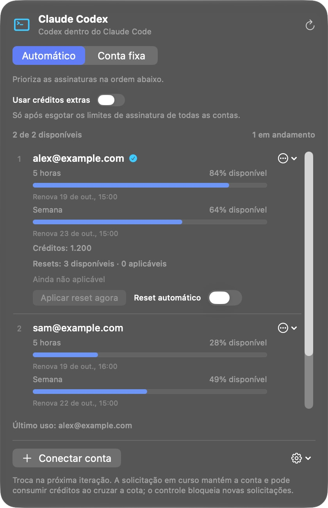

[English](../../README.md) · **Português (Brasil)** · [Español](README_es.md) · [Français](README_fr.md) · [Deutsch](README_de.md) · [Italiano](README_it.md)

  

# Claude Codex

**Use suas assinaturas do Codex dentro do Claude Code. Sem chave de API.**

O Claude Codex é um app nativo para a barra de menus do Mac que conecta suas contas OpenAI/Codex ao Claude Code no aplicativo desktop do Claude. Ele cria uma instalação separada do Claude, com dados e configurações próprios, preservando sua instalação original.

Conecte múltiplas contas, defina a ordem de uso e acompanhe cotas, renovações, créditos e resets de cada uma em um único painel.

**[Baixar para Mac](https://github.com/reyhenrick/claude-codex/releases/latest/download/ClaudeCodex-macOS.dmg)**

macOS 26 ou posterior · Apple silicon e Intel · Gratuito e de código aberto

Requer uma conta com acesso ao Codex e o app oficial do Claude instalado. O uso dos modelos segue os limites e a cobrança da sua conta.

  
   Captura de tela do app em execução, com contas e dados de uso sintéticos.

## Instalar e conectar

1. Abra o DMG, arraste o **Claude Codex** para **Aplicativos** e abra-o.
2. Clique em **Conectar conta** e conclua o login na página oficial da OpenAI. Repita para cada conta que deseja usar.
3. Abra **Opções do app → Nova instalação do Claude…** e selecione o aplicativo oficial do Claude instalado.
4. Dê um nome à instalação separada e escolha se deseja migrar dados locais compatíveis. Feche o Claude de origem antes da migração.
5. Clique em **Criar instalação** e abra o novo app pelo Finder para começar a usar o Claude Code com suas contas do Codex.

O download inclui o runtime necessário; Node.js e Python não precisam ser instalados à parte. O app não é notarizado pela Apple. Se o macOS bloquear a primeira abertura, siga as [instruções da Apple](https://support.apple.com/pt-br/102445).

## Modelos e trabalho com agentes

Use **GPT-6.1 Sol, GPT-6 Luna e GPT-6 Astra** com as ferramentas, os subagentes e os Workflows do Claude Code. Selecione o esforço de raciocínio nativo e as variantes de velocidade disponíveis nas suas contas. Sol e Astra oferecem Normal, Fast e Ultrafast; Luna oferece Normal e Fast. A disponibilidade e o consumo são determinados pela OpenAI.

Reabra a instalação separada do Claude após alterar contas ou acessos a modelos para atualizar o menu de modelos. A seleção de conta, por sua vez, vale para a próxima chamada ao modelo.

## Múltiplas contas, cotas e resets

- **Automático:** tenta as contas elegíveis na ordem escolhida. **Conta fixa:** usa apenas a conta selecionada.
- **Uso:** mostra cotas de assinatura, renovações, créditos extras e resets disponíveis em cada conta.
- **Créditos extras:** começam desativados. Ao ativá-los, novas chamadas podem usar créditos somente após confirmar o esgotamento das cotas de assinatura de todas as contas conectadas.
- **Resets:** aplique um reset disponível manualmente, com confirmação, ou habilite resets automáticos por conta a 5% ou menos de cota restante, quando elegível. Resets automáticos começam desativados.

A troca vale para a próxima chamada ao modelo, inclusive o próximo passo após uma ferramenta. Uma chamada já iniciada continua na conta original e pode atravessar a cota e consumir créditos conforme as regras do fornecedor.

## Traga seu contexto local

Migre históricos locais compatíveis do Claude Code, instruções, memórias e skills. Os dados originais são preservados, e **Mostrar relatório de migração** lista o que foi copiado ou ignorado. Conversas apenas na nuvem e credenciais não são importadas; parte do histórico local é preservada como arquivos portáteis, em vez de sessões retomáveis.

A conexão funciona localmente no Mac. Chamadas aos modelos e resultados de ferramentas são enviados à OpenAI pela conta selecionada. O Claude Codex não tem telemetria própria.

## Atualizações

A busca por atualizações é automática. Use **Buscar atualizações…** nas Opções do app para instalar uma versão. A instalação automática é opcional e começa desativada; a instalação aguarda o término das conversas e operações de conta em andamento. Isso atualiza o Claude Codex, não a cópia separada do Claude.

## Documentação e contribuições

Consulte [CONTRIBUTING.md (English)](../../CONTRIBUTING.md) para compilar, testar, traduzir e reproduzir as capturas com contas sintéticas. A [referência técnica](../TECHNICAL_GUIDE_pt-BR.md) detalha migração, contexto, políticas de contas, privacidade, empacotamento e remoção.

[Relatar um problema](https://github.com/reyhenrick/claude-codex/issues) · [Versões](https://github.com/reyhenrick/claude-codex/releases) · [Licença MIT](../../LICENSE) · [Avisos de terceiros](../../THIRD_PARTY_NOTICES.md)

Projeto independente, sem afiliação com OpenAI ou Anthropic.
